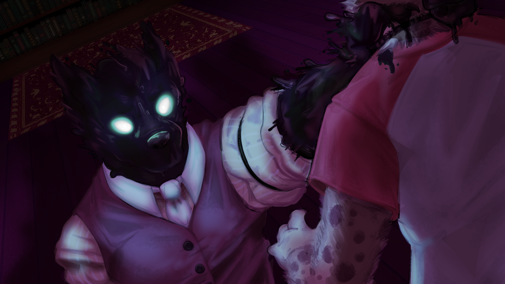
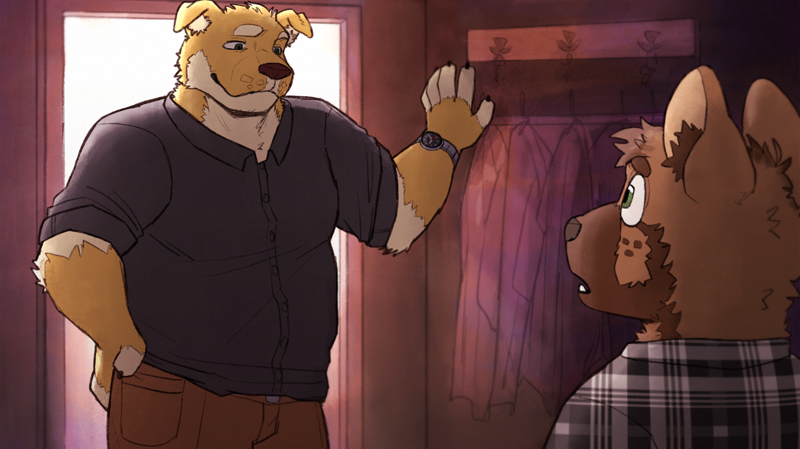

> 回去本就是个错误。有些事最好还是留在过去，因为银石镇里唯一依然存活着的，只有痛苦与折磨的化身。{.text-center}

## 项目简介

::: media-flow right

:::

俄勒冈州的沿海鬼镇“银石镇”（Silverstone），人口不足50人。

它正等待着那些离乡背井的人们归来，跌跌撞撞地重新坠入它的疯狂之中。

Zeke Hames于2002年从家乡银石镇撤离。对于引发撤离的缘由，他毫无记忆，

也与那些亲近的人失去了联系。15年后，他终于重新联系上了那些来自沿海小镇的朋友。

这群人决定重返这座曾经繁华的城市，试图为过去画上句号。

然而，在银石镇的风声中，Zeke Hames的心魔依旧如影随形，
而他的朋友们也各自怀揣着想要永远埋葬的秘密。

一座根本不存在的灯塔频频出现在Zeke Hames的梦中；

团队内部开始滋生摩擦；

而这座小镇本身，似乎也透着一股诡异。

## 3版本说明：
1. 字号放大，弥补不同字体的差异  
2. 去除文本中的空格，修改符号标签  
3. 翻译了最新内容  
4. 翻译仅供玩家参考交流，不代表当前汉化的最高品质。如遇错字、病句、译文偏离原意或严重失真请QQ反馈

## 汉化

- 翻译：Fin无名，hank，奈亚
- 校对：hank
- 程序处理：Fin无名，雨笋，
- 图标：-1℃
- 当前汉化版本：3.0

## 作者原链接
::: media-strip 4

:::