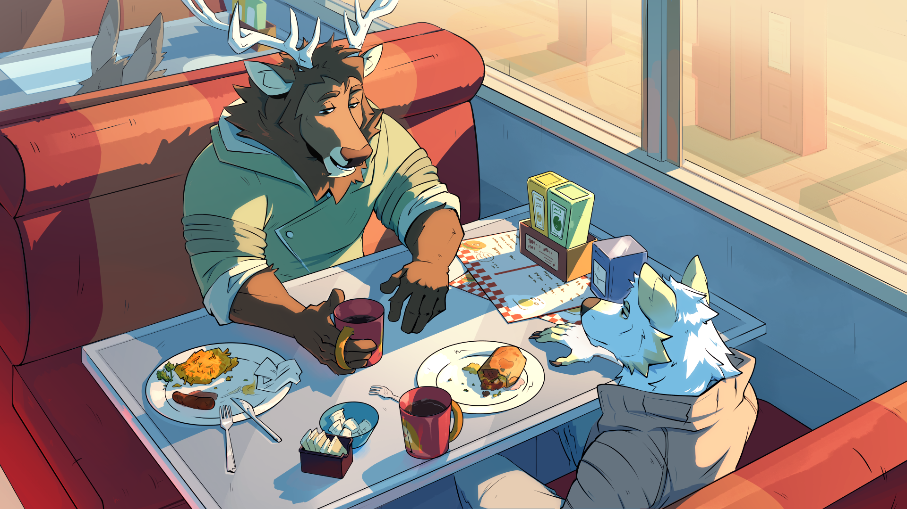
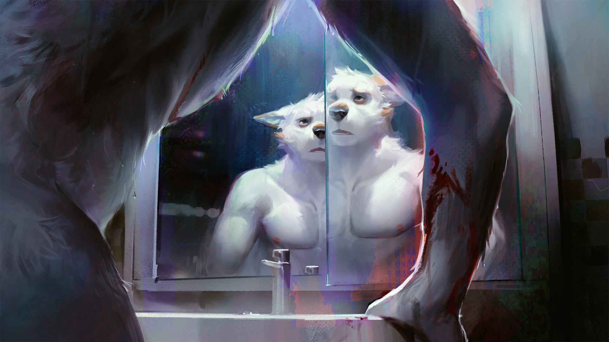
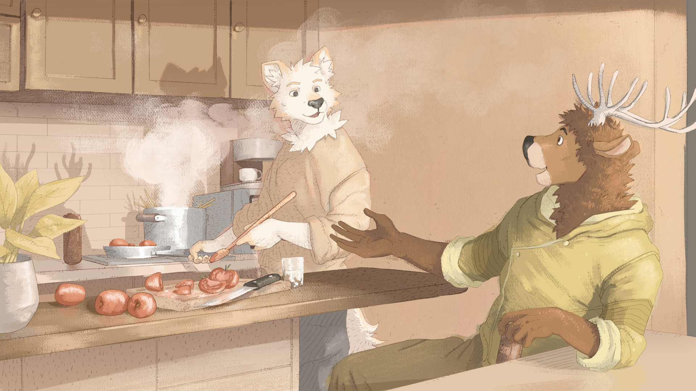

他们累断了腰，只为把摩洛克托上天堂！人行道、树木、收音机，{.text-center}

成吨又成吨的一切！把整座城市托上那个本就存在、且环绕着我们的天堂！{.text-center}

《嚎叫》艾伦·金斯堡{.text-center}

## 项目简介

::: media-flow right

:::

世界迎来了终结。但无偿加班却没有。

《天堂|下》是一款免费的18+赛博朋克浪漫线性视觉小说，围绕艺术、生存以及构建一段值得为之奋斗的人生展开。

Julian是穹顶城市【米吉多】的一名清洁无人机操作员，同时也是虚拟世界【交互域】里的一名业余画家。他对平静的生活感到知足。然而，当一位本以为早已死去的旧友突然现身，并且还缺失了整整两年的记忆时，他日常的宁静被彻底打破了。

Ash的一生充满坎坷，即便在眼下这场麻烦之前也是如此。他逃离了所有认识的人和事，接纳了自己的性别认同并完成了跨性别转变，为了生存寸步不让地战斗。如今，他发现自己再次陷入苦战，而这一次，他或许无法单凭自己获胜了。

然而，就在两人重新相识，并努力应对生存的现实难题与彼此间萌芽的情愫时，艾什过去的谜团却变得越来越危险。随着两人为了拯救他而越走越近，他们也将被卷入一张足以撼动世界根基的阴谋大网之中。

内容警告：
《天堂|下》包含明确的裸露和性描写，仅面向成年观众。故事的某些部分涉及心理健康、自残和自杀、暴力、药物使用以及医疗恐怖等话题，可能不适合所有观众。

###  探索米吉多的世界
深入探索地球最后幸存者的生活与文化，解开他们存在核心深处的谜团。
###  每个故事都有两面
跟随Ash和Julian截然不同的视角，见证他们如何携手并肩为生存而战。
###  一个完全成型的未来
欣赏大量手绘背景和动画CG，并在每次更新中不断扩充！

## 7版本说明：
1. 汉化第七章
2. 同一术语名词
3. 优化1，6，7章文本
4. 更改游戏字体，优化界面显示
5. 为部分内容添加Wikipedia链接
6. 翻译仅供玩家参考交流，不代表当前汉化的最高品质。如遇错字、病句、译文偏离原意或严重失真请QQ反馈

## 汉化人员
### 参考游戏设置页人员名单

## 作者原链接

::: media-strip 3

:::
