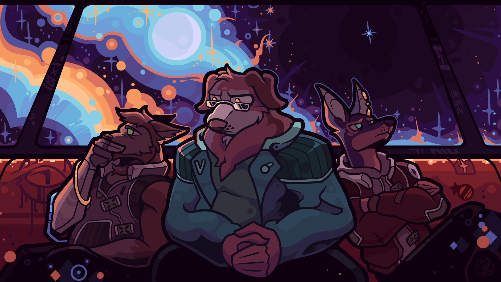

> 这是一个专门用于展示 Markdown 排版的样例页面，可以复制其结构后再替换正式内容。

## 双图对照

使用双列图片组展示同一类内容。

::: media-grid 2

:::

两列图片下方继续使用普通正文。

## 居中图片

单张图片可以使用居中布局，最大宽度为 `720px`。

::: media-block center

:::

## 全宽图片

需要强调横向截图时，可以使用全宽布局。

::: media-block full

:::

## 内容结构

- 一级内容使用 `##`。
- 子内容使用 `###`。
- 图片组合使用 `media-block`、`media-stack` 或 `media-grid` 容器。
- 不要在正文重复游戏名和汉化状态。
