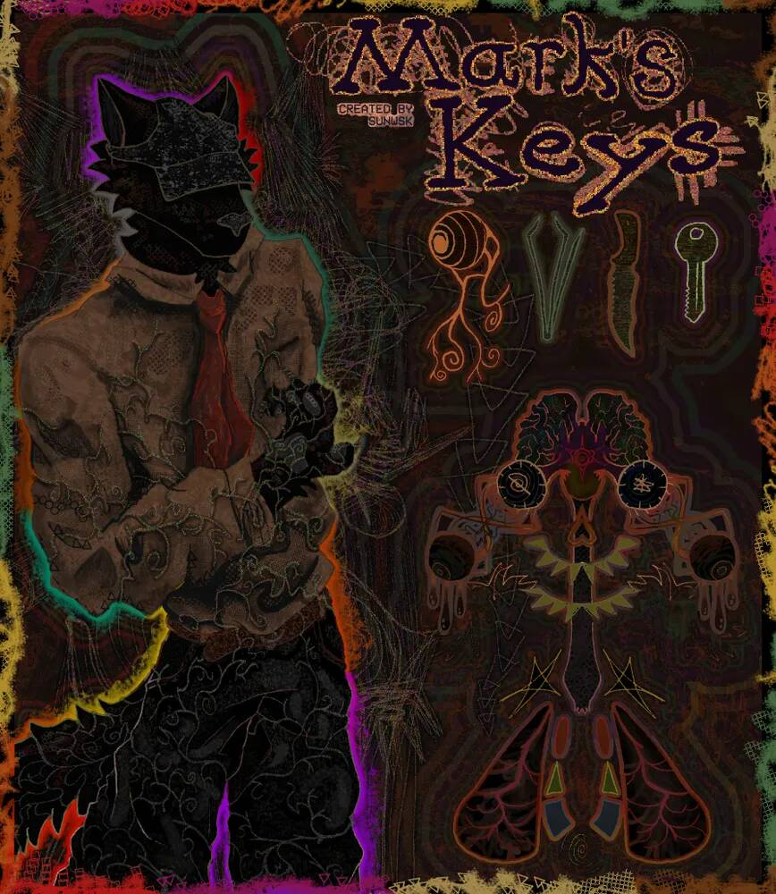

我们的生命太过短暂{.text-right}

没有那么多时间可供憎恨{.text-right}
## 项目简介

::: media-flow right

:::

你坐起身，阴云般的伤感在脑中凝聚，那些一再向人承诺的话语开始动摇——你当真不是一个废物吗?你当真能做到什么吗？你所选的路当真正确吗？火焰从心底呼啸而来。有那么一瞬间，你曾想让过往的一切付之一炬…

“而那火星很早便已点燃。”

《Mark's Keys》是一部简短而极具冲击力的视觉小说，讲述了不合群的野狼马克（Mark）某个糟糕的清晨。作为一名心事重重、不苟言笑的安保人员，他的一天充满波折。顶着压力寻找钥匙，赶去上班，硬着头皮熬过一整天，并试图无视内心深处正在溃烂的一切。

《Mark's Keys》的主题围绕人格解离、逃避心理与存在主义展开。游戏剧情试图深化这些主题，但最终走向了崩坏。而这种崩塌的痕迹，就隐藏在细节之中。

内容警告：包含闪光画面、粗口、血液/受伤细节以及沉重/黑暗的主题。建议16岁以上游玩。

这部视觉小说中的大部分内容都可以自行解读，但如果你想更多了解马克、更深层的主题以及我对这部视觉小说的创作（或者只是支持一个小画师）， 可以考虑花 3 英镑或更多购买金版。

你会得到一个包含以下内容的压缩包：

- 全质量 OST WAV 文件 + 2 首未使用的额外曲目
- 未使用的角色与背景艺术作品
- 马克的详细角色卡
- 3 漫画，2 个分镜和 3 个开发中使用的信息表
- 包含30+幅涂鸦及马克完成的作品的艺术文件夹
- 对制作过程的解释及对艺术家的建议

完整原声带可在 Bandcamp 和 YouTube 上观看

## 1版本说明：  
1. 翻译仅供玩家参考交流，不代表当前汉化的最高品质。如遇错字、病句、译文偏离原意或严重失真请QQ反馈

## 汉化

- 翻译：Fin无名
- 校对：hank
- 程序处理：Fin无名，雨笋
- 当前汉化版本：1

## 作者原链接
::: media-strip 4

:::

