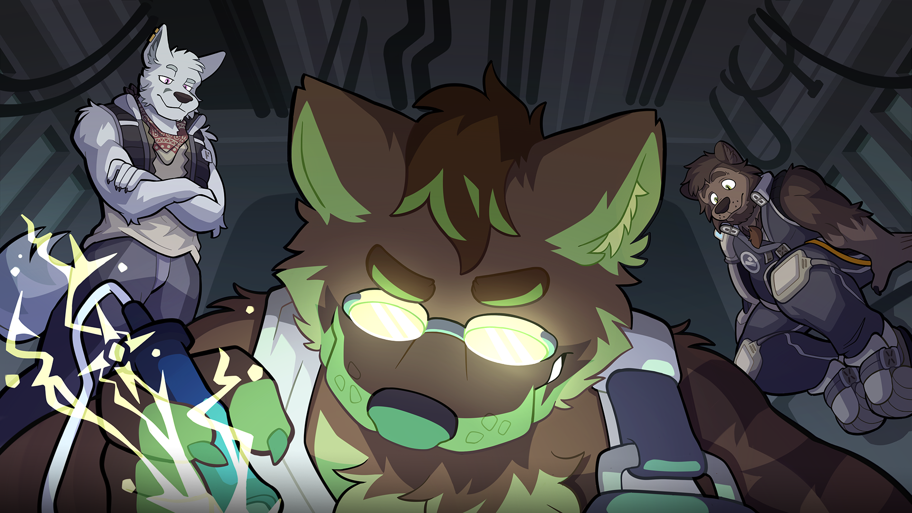
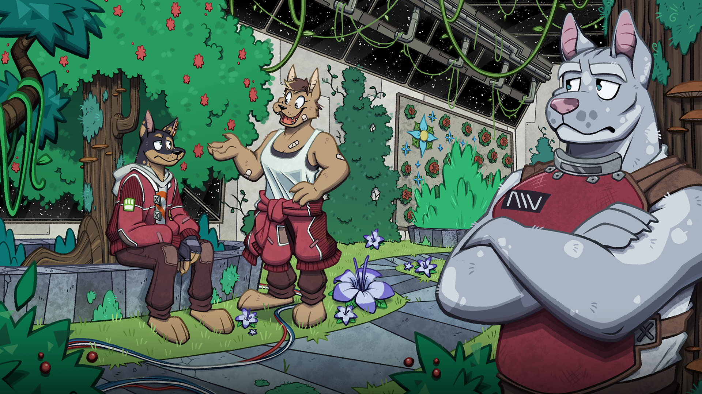
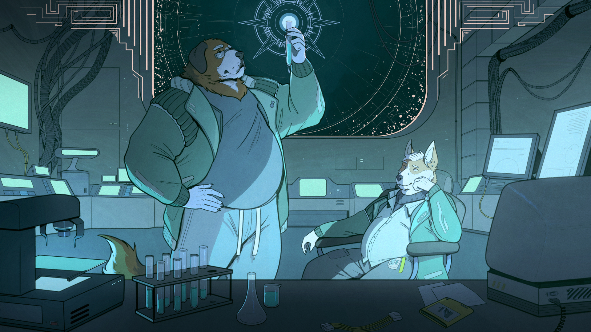
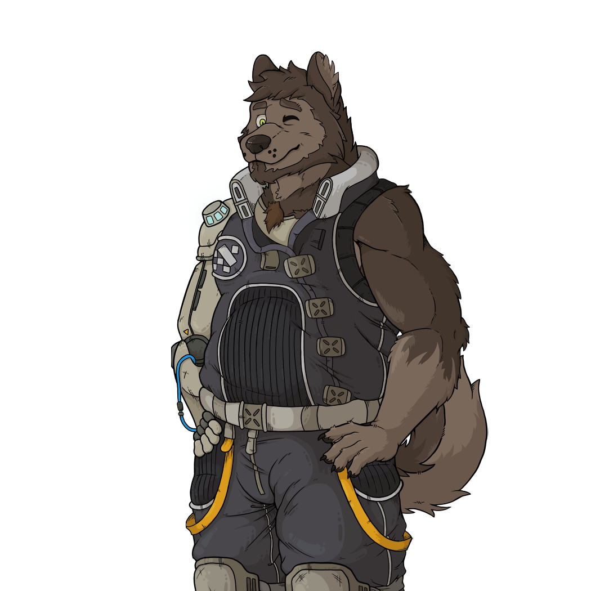
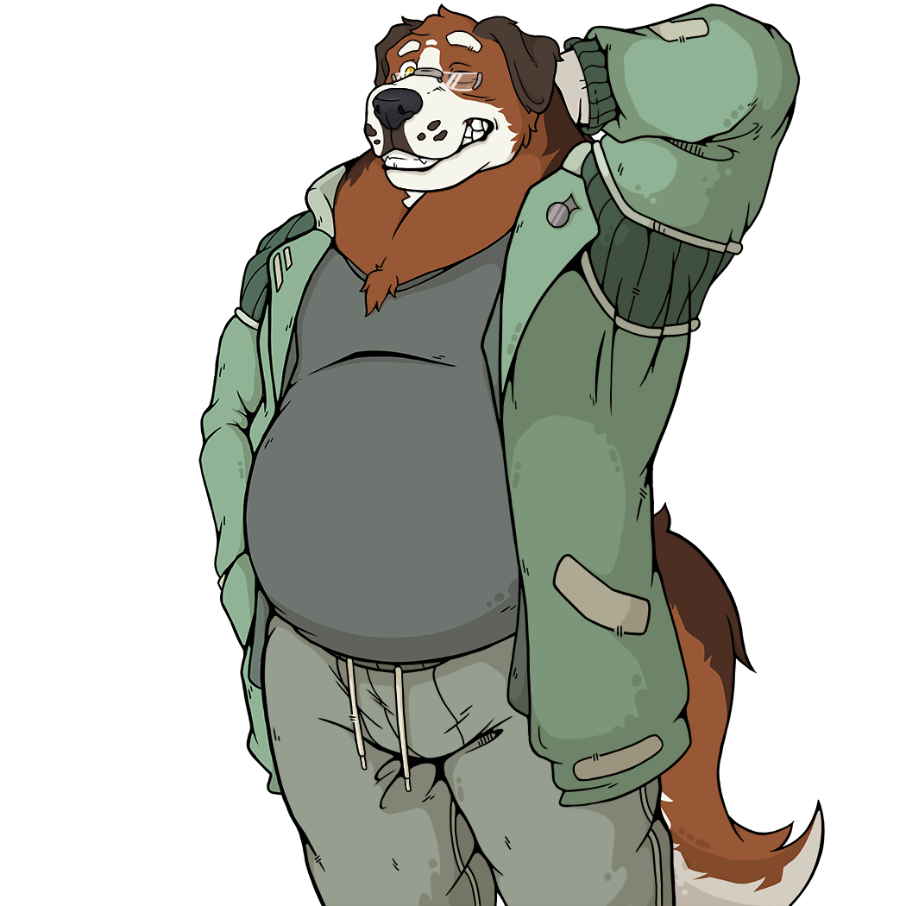
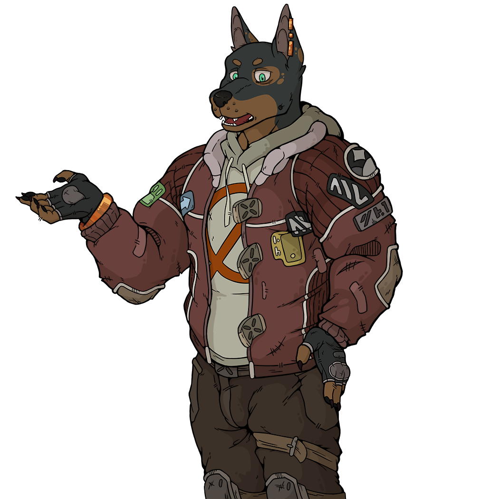

不惧远高，不惧坠落，{.text-right}

惟恐攀登之不足，见地平之辽阔。{.text-right}

————【伊科里奥德】一号（未寻回）{.text-right}

## 项目简介

::: media-flow right

:::

你是否认为自己能改变这个世界？无论你为何人，所能及者终有边界，

所拥有的不过瞬息光阴，欲撼动天地，其力何其微渺。

一如往昔，你又一次踏上了开学第一天的路途。

这并非易事——初临新境的忐忑萦绕心头，但你终究从容应对。

这便是你如今的生活，一场在迁徙与崭新开端间循环的旅途。

万物恒常流转，无一停驻。而今日，亦无不同。转瞬之间，

一切荡然无存。归途渺茫，你该如何自处？

新结识的同伴能否护你周全？抑或这一切终将难以承受？

但请继续前行吧，毕竟，你已再无旁失。

## 11版本说明：  
1. 默认主角名称可热切换  
2. 字号放大，弥补不同字体的差异  
3. 去除文本中的空格，修改符号标签  
4. 翻译了最新一天  
5. 修复了已知错误  
6. 增加汉化人员列表  
7. 翻译仅供玩家参考交流，不代表当前汉化的最高品质。如遇错字、病句、译文偏离原意或严重失真请QQ反馈

## 汉化

- 翻译：参考游戏内人员表。
- 校对：参考游戏内人员表。
- 程序处理：参考游戏内人员表。
- 当前汉化版本：11。

## 主要角色

### 郎恩·蒂兰

::: media-flow right

:::

"郎恩似乎是个显而易见的选择"  
"他善良、体贴，而且似乎对我真的充满好奇。"  
"他可能有点心不在焉，但说实话，我要是对此抱怨那可就太虚伪了！"  
"我也想多了解他一些。尽管他对很多事都很坦率，却依然透着几分神秘。"  
"我已做出选择。"  

原英文名:Rhoun  
年龄：二十七【伊耶安】周期  
职位：【伊科里奥德】二号的维修总监  
出生地：【伊约】赤道附近的【板区】？（游戏内未具体说明，待补充）  
犬种：游戏内未提到  
性格标签：内向、焦虑/ 口吃  
首次登场:Day0  

人际关系：
与马洛温的关系作正常朋友  
与马鲁克的关系源于某次意外而导致了恶化  
与作为二把手的凯斯关系十分亲密  
与小跟班麦洛的关系十分亲密  
与提尔，船长为上下级关系  

###   

### 马洛温·森诺

::: media-flow right

:::

"马洛温似乎是唯一明智的选择。"  
"自从我来到这儿，他自始至终都表现得无可挑剔，  
甚至还对我特意处处关照，让我过得更顺心些。"  
 "虽说是个外表威严的人，但他确实是位真诚善良的卡莱恩。"  
"我已做出选择。"  

马洛温原英文名Marrowyn  
年龄：三十四【伊耶安】周期  
职位：【伊科里奥德】二号的首席医师  
出生地：【伊约】？（游戏内未具体说明，待补充）  
犬种：圣伯纳犬  
性格标签：真诚，待人友善/专业  
首次登场:Day0  

人际关系：
与郎恩的关系为正常朋友  
与马鲁克的关系较好  
与佩特尔的关系较好  
与提尔为（养）父子关系  
与船长为普通上下级关系  

###   

### 马鲁克·塞拉斯

::: media-flow right

:::

"马鲁克是个……有趣的选择。"  
"他完全是个混蛋。这一点毫无疑问。"  
"但只要我不老烦他，他又能睡自己床上，我觉得他会冷静下来的。"  
"我觉得他不是个坏人或者什么的，只是可能……压力太大了。"  
"等离开这儿后，我肯定能看到更多他好的那一面。"  
"总之，和他同住绝对是最安全的。"  
"我已做出决定。"  

马鲁克原英文名Marruk  
年龄：二十九【伊耶安】周期  
职位：【伊科里奥德】二号的安保主管  
出生地：【乌里温】  
犬种：灵缇  
性格标签：直白，粗鲁/傲娇  
首次登场:Day0  

人际关系：
与马洛温的关系较好  
与郎恩的关系源于某次意外而导致了恶化  
与诺切的关系较好  
与泰尤的关系十分亲密  
与提尔，船长为普通上下级关系  

###    

最后更新时间：2026/10/15{.text-right}

（内容源于游戏内，并非作者原设定，并会不定期删改。）{.text-right}

## 作者原链接
::: media-strip 4

:::

